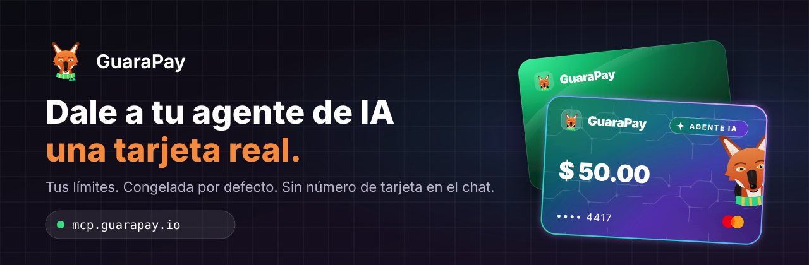
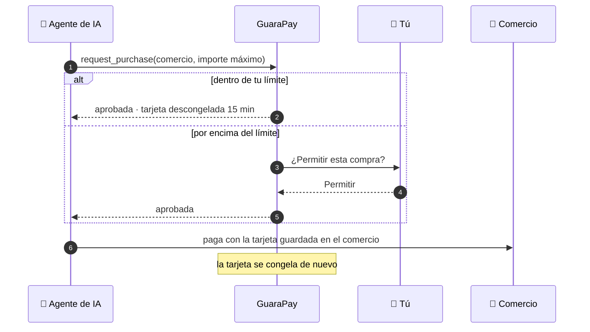

<p align="center">
  <a href="https://guarapay.io/es/?utm_source=github&utm_medium=mcp&utm_campaign=readme_es"></a>
</p>

<p align="center">
  <a href="README.md">English</a> · <b>Español</b>
</p>

<p align="center">
  <a href="https://modelcontextprotocol.io"></a>
  <a href="https://registry.modelcontextprotocol.io/v0/servers?search=io.guarapay"></a>
  <a href="#seguridad"></a>
  
  
</p>

<p align="center">
  <a href="https://glama.ai/mcp/connectors/io.guarapay/card"></a>
</p>

<h3 align="center">El agente de pagos con IA para Claude, ChatGPT, Cursor y cualquier cliente MCP</h3>

<p align="center">
Tu agente emite una tarjeta virtual, la recarga y paga — dentro de los límites que tú fijas.<br>
Nunca ve el número de la tarjeta. La tarjeta sigue congelada hasta que se aprueba una compra.
</p>

<p align="center"><code>https://mcp.guarapay.io</code></p>

---

## Contenido

- [Por qué GuaraPay](#por-qué-guarapay)
- [Inicio rápido](#inicio-rápido)
- [Pruébalo](#pruébalo)
- [Cómo funciona una compra](#cómo-funciona-una-compra)
- [Recarga](#recarga)
- [Herramientas](#herramientas)
- [Seguridad](#seguridad)
- [Preguntas frecuentes](#preguntas-frecuentes)

## Por qué GuaraPay

Los agentes investigan, comparan y rellenan el checkout — y se detienen en el pago.
Pegar tu propia tarjeta en el chat no es la solución.

| | Tu tarjeta en el chat | **Tarjeta de agente GuaraPay** |
|---|:---:|:---:|
| El agente ve el número y el CVV | ❌ sí | ✅ nunca |
| Tope de gasto aplicado por la propia tarjeta | ❌ | ✅ diario + mensual |
| Tarjeta congelada entre compras | ❌ | ✅ se descongela 15 min por compra aprobada |
| Las compras grandes necesitan tu confirmación | ❌ | ✅ por encima del límite |
| Saldo separado de tu dinero principal | ❌ | ✅ |
| Quitar el acceso al agente con un toque | ❌ | ✅ |

## Inicio rápido

Añade el servidor — el inicio de sesión de GuaraPay se abre la primera vez.

<details open>
<summary><b>Claude</b> · claude.ai y Desktop</summary>
<br>

Configuración → Conectores → **Añadir conector personalizado** → `https://mcp.guarapay.io`
</details>

<details>
<summary><b>Claude Code</b></summary>

```sh
claude mcp add --transport http guarapay https://mcp.guarapay.io
```
</details>

<details>
<summary><b>ChatGPT</b></summary>
<br>

Configuración → Apps y conectores → Avanzado → **Modo desarrollador** → Crear → `https://mcp.guarapay.io`
</details>

<details>
<summary><b>Cursor</b> · <code>~/.cursor/mcp.json</code></summary>

```json
{
  "mcpServers": {
    "guarapay": { "url": "https://mcp.guarapay.io" }
  }
}
```
</details>

<details>
<summary><b>VS Code</b> · <code>.vscode/mcp.json</code></summary>

```json
{
  "servers": {
    "guarapay": { "type": "http", "url": "https://mcp.guarapay.io" }
  }
}
```
</details>

<details>
<summary><b>Docker</b> · clientes stdio</summary>

Para un cliente que solo ejecuta servidores locales (stdio). La imagen conecta stdio con `https://mcp.guarapay.io`;
abre el enlace de inicio de sesión que imprime, y el token se guarda en el volumen `guarapay-mcp`.

```json
{
  "mcpServers": {
    "guarapay": {
      "command": "docker",
      "args": ["run", "-i", "--rm", "-p", "3334:3334", "-v", "guarapay-mcp:/data", "ghcr.io/guarapay-ai/mcp"]
    }
  }
}
```
</details>

<details>
<summary><b>Cualquier cliente MCP</b></summary>
<br>

| | |
|---|---|
| Transporte | Streamable HTTP |
| URL | `https://mcp.guarapay.io` |
| Autenticación | OAuth 2.1, PKCE (S256), registro dinámico de clientes |
| Metadatos del recurso | `https://mcp.guarapay.io/.well-known/oauth-protected-resource` |
</details>

Después, en la app de GuaraPay: abre una tarjeta → **Agente de IA** → fija los límites diario y mensual.

## Pruébalo

```text
› Consígueme una tarjeta GuaraPay para suscripciones y recárgala con 30 $.
› Paga el plan Standard de Midjourney con mi tarjeta de agente.
› ¿Cuánto gastó el agente este mes y cuánto queda del límite?
› Congela la tarjeta, por hoy ya está.
```

## Cómo funciona una compra



## Recarga

| Forma | Cómo funciona |
|---|---|
| 💳 **Tarjeta bancaria · Apple Pay · Google Pay** | El agente te envía un enlace de pago seguro; pagas y la tarjeta se acredita |
| 🪙 **USDT** | Dirección de depósito y QR de la tarjeta; se acredita minutos después de la confirmación de la red |

`quote_deposit` muestra el tipo de cambio, la comisión y lo que llega a la tarjeta antes de enviar nada.

## Herramientas

<table>
<tr><th>Cuenta y tarjetas</th><th>Recarga</th><th>Pagos</th></tr>
<tr valign="top"><td>

`get_account` — cuenta, verificación, tarjetas, saldos<br>
`card_plans` — comisiones y límites mensuales<br>
`issue_card` — emitir una tarjeta virtual<br>
`freeze_card` — congelar una tarjeta<br>
`list_transactions` — compras, recargas, comisiones, rechazos<br>
`card_details_link` — datos en la app, solo para ti

</td><td>

`payment_methods` — formas de pago para este cliente<br>
`payment_link` — enlace para la forma elegida<br>
`deposit_to_card` — dirección USDT y QR<br>
`quote_deposit` — tipo, comisión e importe neto<br>
`list_deposits` — estado de los depósitos

</td><td>

`get_agent_card` — límites, gastado, compra en curso<br>
`request_purchase` — pedir el pago de una compra<br>
`get_purchase` — pending · approved · used · rejected<br>
`list_purchases` — compras que pidió el agente<br>
`cancel_purchase` — cancelar una compra

</td></tr>
</table>

## Seguridad

- 🔐 **OAuth 2.1 con PKCE.** Inicias sesión con tu cuenta de GuaraPay; puedes revocar el acceso en la app cuando quieras.
- 🎯 **Por tarjeta y a tu elección.** El agente solo ve las tarjetas que pusiste en modo Agente de IA.
- 🧊 **Congelada por defecto.** Una compra aprobada = 15 minutos descongelada, luego vuelve a congelarse.
- 🚫 **Lo que el agente no puede hacer:** ver el número o el CVV, descongelar una tarjeta, cambiar límites, pasar la verificación de identidad, sacar dinero.
- 🪪 **La verificación de identidad (KYC)** la haces tú en la app.

## Preguntas frecuentes

<details>
<summary><b>¿El servidor es de código abierto?</b></summary>
<br>
Este repositorio documenta el servidor alojado en <code>mcp.guarapay.io</code>. El servidor funciona en la infraestructura de GuaraPay; no hay nada que instalar.
</details>

<details>
<summary><b>¿Dónde se fijan los límites?</b></summary>
<br>
En la app de GuaraPay: tarjeta → Agente de IA. El agente puede leerlos, pero no cambiarlos.
</details>

<details>
<summary><b>¿Cómo paga el agente si nunca ve el número de la tarjeta?</b></summary>
<br>
Guardas la tarjeta una vez en el comercio (la app te muestra los datos). Después, el agente pide a GuaraPay que apruebe cada compra y completa el checkout con la tarjeta guardada.
</details>

<details>
<summary><b>Mi cliente muestra herramientas antiguas.</b></summary>
<br>
Quita GuaraPay del cliente y vuelve a añadirlo, o empieza un chat nuevo.
</details>

---

<p align="center">
  <a href="https://guarapay.io/es/?utm_source=github&utm_medium=mcp&utm_campaign=readme_es">guarapay.io</a> ·
  <a href="https://registry.modelcontextprotocol.io/v0/servers?search=io.guarapay">MCP Registry</a>
</p>
