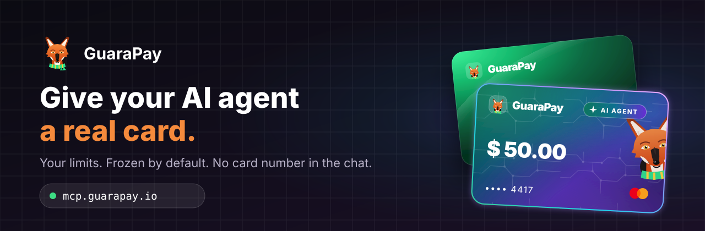
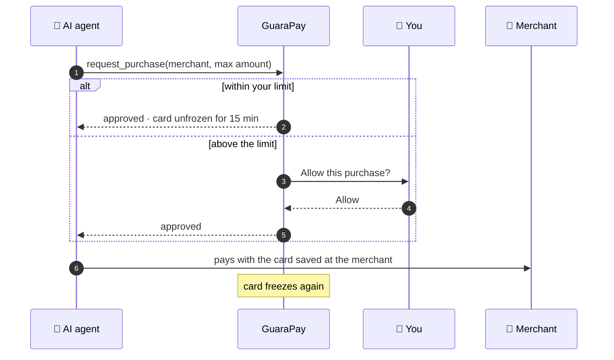

<p align="center">
  <a href="https://guarapay.io/en/ai-agents/?utm_source=github&utm_medium=mcp&utm_campaign=readme"></a>
</p>

<p align="center">
  <b>English</b> · <a href="README.es.md">Español</a>
</p>

<p align="center">
  <a href="https://modelcontextprotocol.io"></a>
  <a href="https://registry.modelcontextprotocol.io/v0/servers?search=io.guarapay"></a>
  <a href="#security"></a>
  
  
</p>

<h3 align="center">The AI Payment Agent for Claude, ChatGPT, Cursor and any MCP client</h3>

<p align="center">
Your agent issues a virtual card, tops it up and pays — inside the limits you set.<br>
It never sees the card number. The card stays frozen until a purchase is approved.
</p>

<p align="center"><code>https://mcp.guarapay.io</code></p>

---

## Contents

- [Why GuaraPay](#why-guarapay)
- [Quick start](#quick-start)
- [Try it](#try-it)
- [How a purchase works](#how-a-purchase-works)
- [Top up](#top-up)
- [Tools](#tools)
- [Security](#security)
- [FAQ](#faq)

## Why GuaraPay

Agents can research, compare and fill a checkout form — and then stop at the payment step.
Pasting your own card into a chat is the wrong fix.

| | Your own card in the chat | **GuaraPay agent card** |
|---|:---:|:---:|
| Agent sees the card number and CVV | ❌ yes | ✅ never |
| Spending cap enforced by the card itself | ❌ | ✅ daily + monthly |
| Card is frozen between purchases | ❌ | ✅ unfreezes for 15 min per approved purchase |
| Big purchases need your tap | ❌ | ✅ above the limit |
| Separate balance from your main money | ❌ | ✅ |
| Revoke the agent in one tap | ❌ | ✅ |

## Quick start

Add the server — the GuaraPay sign-in opens on first use.

<details open>
<summary><b>Claude</b> · claude.ai and Desktop</summary>
<br>

Settings → Connectors → **Add custom connector** → `https://mcp.guarapay.io`
</details>

<details>
<summary><b>Claude Code</b></summary>

```sh
claude mcp add --transport http guarapay https://mcp.guarapay.io
```
</details>

<details>
<summary><b>ChatGPT</b></summary>
<br>

Settings → Apps & Connectors → Advanced → **Developer mode** → Create → `https://mcp.guarapay.io`
</details>

<details>
<summary><b>Cursor</b> · <code>~/.cursor/mcp.json</code></summary>

```json
{
  "mcpServers": {
    "guarapay": { "url": "https://mcp.guarapay.io" }
  }
}
```
</details>

<details>
<summary><b>VS Code</b> · <code>.vscode/mcp.json</code></summary>

```json
{
  "servers": {
    "guarapay": { "type": "http", "url": "https://mcp.guarapay.io" }
  }
}
```
</details>

<details>
<summary><b>Docker</b> · stdio clients</summary>

For a client that only runs local (stdio) servers. The image bridges stdio to `https://mcp.guarapay.io`;
open the sign-in link it prints, and the token is kept in the `guarapay-mcp` volume.

```json
{
  "mcpServers": {
    "guarapay": {
      "command": "docker",
      "args": ["run", "-i", "--rm", "-p", "3334:3334", "-v", "guarapay-mcp:/data", "ghcr.io/guarapay-ai/mcp"]
    }
  }
}
```
</details>

<details>
<summary><b>Any MCP client</b></summary>
<br>

| | |
|---|---|
| Transport | Streamable HTTP |
| URL | `https://mcp.guarapay.io` |
| Auth | OAuth 2.1, PKCE (S256), dynamic client registration |
| Resource metadata | `https://mcp.guarapay.io/.well-known/oauth-protected-resource` |
</details>

Then, in the GuaraPay app: open a card → **AI agent** → set the daily and monthly limits.

## Try it

```text
› Get me a GuaraPay card for subscriptions and top it up with $30.
› Pay for the Midjourney Standard plan with my agent card.
› What did the agent spend this month, and how much of the limit is left?
› Freeze the card — I'm done for today.
```

## How a purchase works



## Top up

| Way | How it works |
|---|---|
| 💳 **Bank card · Apple Pay · Google Pay** | The agent sends you a secure payment link; you pay, the card is credited |
| 🪙 **USDT** | Deposit address and QR for the card; credited a few minutes after network confirmation |

`quote_deposit` shows the rate, the fee and what lands on the card before you send anything.

## Tools

<table>
<tr><th>Account & cards</th><th>Top up</th><th>Paying</th></tr>
<tr valign="top"><td>

`get_account` — account, verification, cards, balances<br>
`card_plans` — fees and monthly limits<br>
`issue_card` — issue a virtual card<br>
`freeze_card` — freeze a card<br>
`list_transactions` — purchases, top-ups, fees, declines<br>
`card_details_link` — details in the app, for you only

</td><td>

`payment_methods` — ways to pay for this client<br>
`payment_link` — link for the chosen way<br>
`deposit_to_card` — USDT address and QR<br>
`quote_deposit` — rate, fee and net amount<br>
`list_deposits` — deposit status

</td><td>

`get_agent_card` — limits, spent, purchase in progress<br>
`request_purchase` — ask to pay one purchase<br>
`get_purchase` — pending · approved · used · rejected<br>
`list_purchases` — purchases the agent asked for<br>
`cancel_purchase` — cancel a purchase

</td></tr>
</table>

## Security

- 🔐 **OAuth 2.1 with PKCE.** Sign in with your GuaraPay account; revoke access any time in the app.
- 🎯 **Opt-in per card.** The agent sees only the cards you put in AI agent mode.
- 🧊 **Frozen by default.** One approved purchase = 15 minutes unfrozen, then frozen again.
- 🚫 **What the agent cannot do:** see the card number or CVV, unfreeze a card, change limits, pass identity verification, move money out.
- 🪪 **Identity verification (KYC)** is done by you in the app.

## FAQ

<details>
<summary><b>Is the server open source?</b></summary>
<br>
This repository documents the hosted server at <code>mcp.guarapay.io</code>. The server runs on GuaraPay infrastructure; there is nothing to install.
</details>

<details>
<summary><b>Where are the limits set?</b></summary>
<br>
In the GuaraPay app: card → AI agent. The agent can read them but cannot change them.
</details>

<details>
<summary><b>How does the agent pay if it never sees the card number?</b></summary>
<br>
You save the card once at the merchant (the app shows you the details). After that the agent asks GuaraPay to approve each purchase and completes checkout with the saved card.
</details>

<details>
<summary><b>My client shows old tools.</b></summary>
<br>
Remove GuaraPay from the client and add it again, or start a new chat.
</details>

---

<p align="center">
  <a href="https://guarapay.io/?utm_source=github&utm_medium=mcp&utm_campaign=readme">guarapay.io</a> ·
  <a href="https://guarapay.io/en/ai-agents/?utm_source=github&utm_medium=mcp&utm_campaign=readme">AI agents</a> ·
  <a href="https://registry.modelcontextprotocol.io/v0/servers?search=io.guarapay">MCP Registry</a>
</p>
